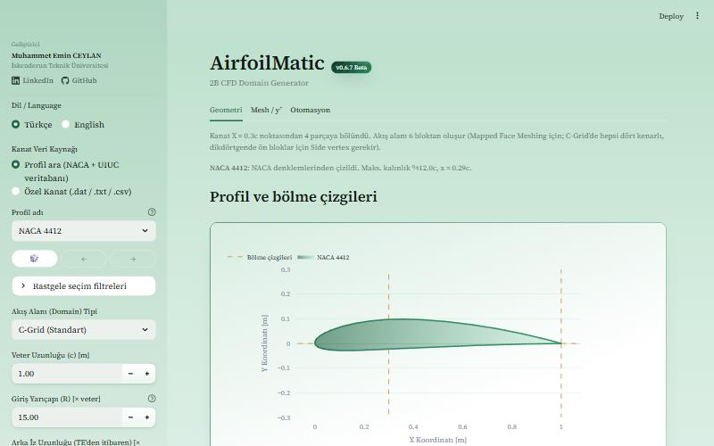
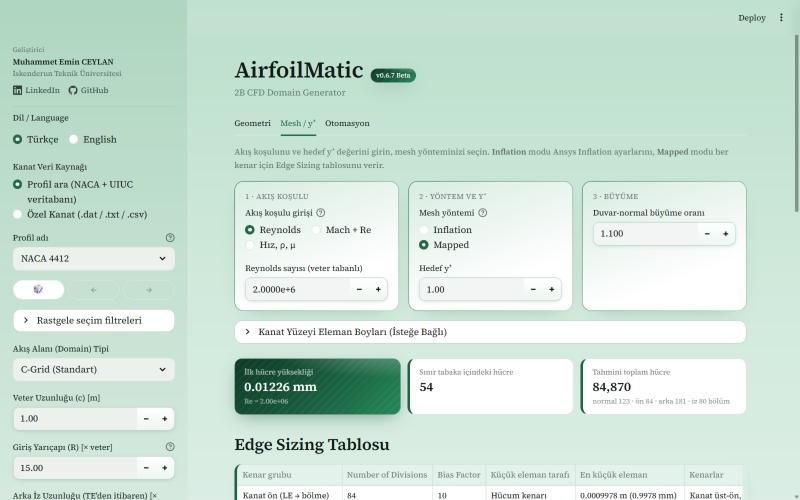

# AirfoilMatic V0.6.7 Beta — 2B CFD Domain Generator

**Türkçe** | [English](README.en.md)

[](https://airfoilmatic.streamlit.app/)
[](https://github.com/meceylan/AirfoilMatic/actions/workflows/tests.yml)
[](LICENSE)

Bir kanat profili seçin; AirfoilMatic, Ansys Fluent'te 2B analiz için etrafındaki akış alanını (C-Grid ya da dikdörtgen, altı dört kenarlı blok) kurar, DesignModeler / SpaceClaim için geometriyi ya da doğrudan Fluent mesh dosyasını (.msh) verir, y⁺'a göre mesh ayarlarını ve Fluent'e girilecek değerleri hesaplar.

**[Tarayıcıda çalıştır → airfoilmatic.streamlit.app](https://airfoilmatic.streamlit.app/)** (kurulum gerekmez)





## Özellikler
* **Profil:** NACA 4 / 5 haneli (denklemden), UIUC veritabanından seçilmiş 300 profil (yazarken öneri, 🎲 rastgele profil) ya da kendi `.dat` / `.txt` / `.csv` dosyanız (Selig, Lednicer; birim, orijin ve nokta sırası fark etmez). Uygulama profil uydurmaz: listede olmayan ad için "veritabanında yok" der.
* **Domain ve geometri:** C-Grid ya da dikdörtgen domain, 6 dört kenarlı blok; DesignModeler TXT ve SpaceClaim TXT; yalnız profil için SolidWorks ZIP; **m / mm** çıktı birimi.
* **Fluent mesh dosyası (.msh):** C-Grid ya da dikdörtgen domain'in mapped mesh'ini uygulama kendisi üretir (transfinite interpolasyon; sınırlar `inlet`, `outlet`, `wall`); DesignModeler ve Meshing gerekmez. En çok 1 000 000 hücre.
* **Mesh / y⁺:** hedef y⁺ için ilk hücre yüksekliği; Ansys Inflation ayarları ya da mapped mesh için Edge Sizing tablosu; mesh kalite kontrolü; ilk Fluent sonucundan y⁺ düzeltmesi.
* **Mesh bağımsızlığı:** kaba / orta / ince üç mesh tek ZIP'te (hücre boyları √2 oranıyla), report file'lardan **GCI** (Celik vd. 2008).
* **Akış ve Fluent yardımcısı:** Reynolds, Mach + Reynolds + sıcaklık ya da hız + yoğunluk + viskozite; inlet hız bileşenleri, Lift/Drag vektörleri, referans değerler, türbülans sönümü.
* **Otomasyon:** hücum açısı taraması (eşit aralıklı ya da kendi açı listeniz), `aoa` expression'ını değiştiren Fluent journal'ı (`.jou`), report file'dan polar (Cl–α, Cd–α, Cl–Cd).
* **Olduğu gibi modu:** yüklenen çizgi sırası bozulmadan kullanılır; VG, flap ya da kırık profil için (yalnızca Inflation; NACA 4412 ile Fluent 2024 R2'de denendi).
* Ayarları JSON dosyasına kaydet / yükle; Türkçe / İngilizce arayüz.

## Nasıl kullanılır
1. **Profil seçin:** arama kutusu, 🎲 ya da kendi dosyanız.
2. **Domain ve akışı girin:** domain tipi ve boyutu (veter cinsinden), Reynolds ya da Mach, hedef y⁺.
3. **Mesh'i alın**, iki yoldan biriyle:
   * uygulamanın `.msh` dosyasını indirip Fluent'te `File → Read → Mesh`, ya da
   * TXT'yi DesignModeler / SpaceClaim'e aktarıp Ansys Meshing'de Inflation ya da Mapped mesh (adımlar aşağıda).
4. **Fluent'i kurun ve koşun:** Fluent yardımcısındaki değerleri girin; Otomasyon sekmesinden journal ile açı taramasını koşun, report file'ı yükleyip polar ve GCI alın.

<details>
<summary><b>Ansys DesignModeler / Meshing adımları</b></summary>

1. **İçe aktarma:** DesignModeler'da önce `Units` menüsünden kenar çubuğunda seçtiğiniz çıktı birimini (m ise `Meter`, mm ise `Millimeter`) seçin, sonra `Concept > 3D Curve` ile indirdiğiniz `.txt` dosyasını seçip `Generate` deyin.
2. **Yüzey:** `Concept > Surfaces from Edges` ile dış sınırları ve kanat kenarlarını seçerek akış yüzeyini oluşturun.
3. **Bölme:** `Tools > Projection` ile dışa aktarılan bölme çizgilerini kullanın.
4. **Mesh:** **Mesh / y⁺** sekmesi iki akışın da ayarlarını verir.
   * **Inflation (quad-dominant):** ön eksen + iz eksenini (ya da altı çizginin hepsini) dışa aktarın; tek çizgi ya da ön eksen olmadan iz ekseni inflation hatası verir. Tüm yüzeylere `Inflation` ekleyin, Boundary olarak kanat kenarlarını **ve iz eksenini** seçin. Genel Element Size'ı yaklaşık 0.5c yapın ve tablodaki Edge Sizing'leri girin. Sivri firar kenarı kullanın; küt TE + inflation denemelerimizde başarısız oldu.
   * **Mapped:** altı bölme çizgisini de dışa aktarın, tüm yüzeylere `Face Meshing` (Mapped) ekleyip tablodaki `Edge Sizing` değerlerini girin. Aynı bölüm sayılı duvar-normal kenarlara tek bir bias vermek ilk hücreyi en fazla %2 değiştirir.
   * Inflation ile Mapped Face Meshing aynı yüzeyde birlikte kullanılamaz.
5. **Kontrol:** Fluent y⁺'ı hücre merkezinde raporlar; görülen değer hedefin yaklaşık yarısıdır.
6. **Mesh değiştirmek:** kurulu case'i okuyup konsola `/mesh/replace` yazın, dosya adını uzantısıyla verin (`ad.msh`). Zone adları aynıysa (`inlet`, `outlet`, `wall`) sınır koşulları, expression'lar ve report'lar korunur; ardından initialize edin. Fluent 2024 R2'de denendi.

Kanat neden X = 0.3c'den bölünüyor? Hücum kenarındaki yüksek eğrilik ayrılır, dikey bölme çizgileri dış sınıra dik bağlanır (sliver face oluşmaz) ve bütün bloklar dört kenarlı kalır (mapped mesh için). Ayrıntı: [docs/VALIDATION.md](docs/VALIDATION.md#neden-x--03c).
</details>

## Ansys'te ne denendi?
| Ne | Nerede | Sonuç |
|---|---|---|
| Uygulamanın `.msh`'i, C-Grid | Fluent 2024 R2, NACA 4412, −4…8° | Mesh Check hatasız; Cl / Cd Ansys'in mesh'iyle %0.01 / %0.05 içinde |
| Uygulamanın `.msh`'i, dikdörtgen | Fluent 2024 R2, NACA 4412, −4…8° | Cl C-Grid'le %0.2 içinde; Cd 8°'de %1.6 düşük |
| NACA 0012, Ladson deneyi | Fluent 2024 R2, α = 4.25° | Cl %1'den az, Cd %2–3.5 fark; "deneyle uyumlu", kesin doğrulama değil |
| Mesh bağımsızlığı (GCI) | Fluent 2024 R2, NACA 4412, 4° | üç mesh %0.1 içinde |
| Fluent journal'ı | Fluent 2024 R2 (standalone) | çalıştı; Workbench içinde çalışmaz |
| Domain için DesignModeler TXT ve SpaceClaim TXT; profil için SolidWorks ZIP ve SpaceClaim TXT | kullanıcı | denendi |
| Yalnız profil için DesignModeler TXT | — | henüz denenmedi |
| Journal'da case dosyasının üzerine yazma | — | henüz denenmedi |

Kurulumlar, tablolar ve bütün sayılar: **[docs/VALIDATION.md](docs/VALIDATION.md)**.

**Sınırlar:** mesh planı düşük hız içindir (Mach < 0.3; sıkıştırılabilir akışa özel mesh ayarı yok). Yüksek Cl'de domain yarıçapını büyütüp sonucun değişmediğini kontrol edin.

## Yerel kurulum
```bash
git clone https://github.com/meceylan/AirfoilMatic.git
cd AirfoilMatic
pip install -r requirements.txt
streamlit run app.py
```
Testler: `pip install pytest`, ardından `python -m pytest -q`. Python 3.11+, Streamlit, NumPy, Plotly.

## Geliştirici
**Muhammet Emin CEYLAN**, İskenderun Teknik Üniversitesi · [LinkedIn](https://www.linkedin.com/in/muhammet-emin-ceylan-b79847334) · [GitHub](https://github.com/meceylan)

Hata ve önerileriniz için [Issues](https://github.com/meceylan/AirfoilMatic/issues). Değişiklikler: [CHANGELOG.md](CHANGELOG.md).

## Lisans
MIT Lisansı. Arayüz yazı tipi Source Serif 4, SIL Open Font License 1.1 ile dağıtılır (`static/fonts/OFL-SourceSerif4.txt`). Profil seçkisindeki koordinatlar Prof. Michael S. Selig'in yürüttüğü [UIUC Airfoil Coordinates Database](https://m-selig.ae.illinois.edu/ads/coord_database.html)'den alınmıştır ve MIT lisansına dahil değildir; seçki `tools/build_airfoil_library.py` ile yeniden üretilebilir.
